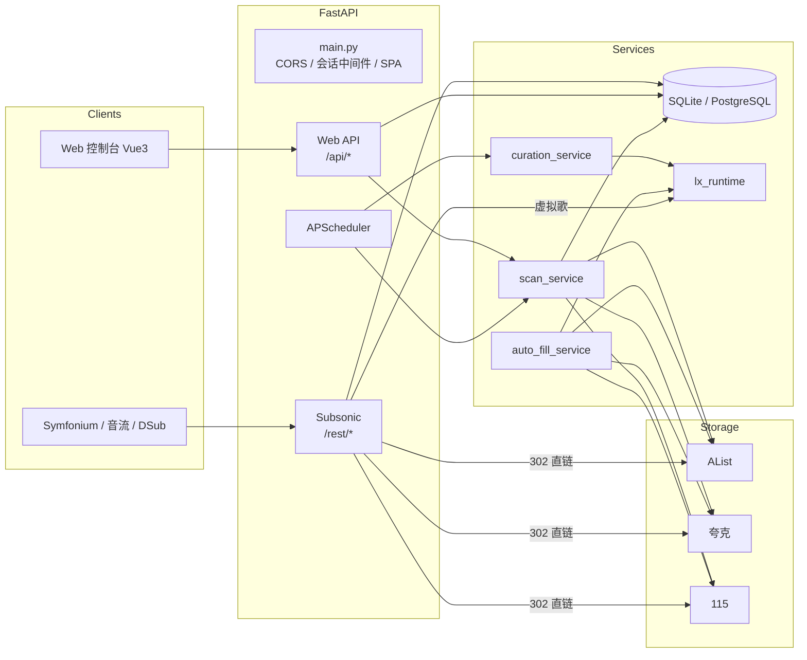
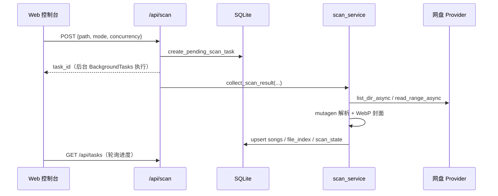
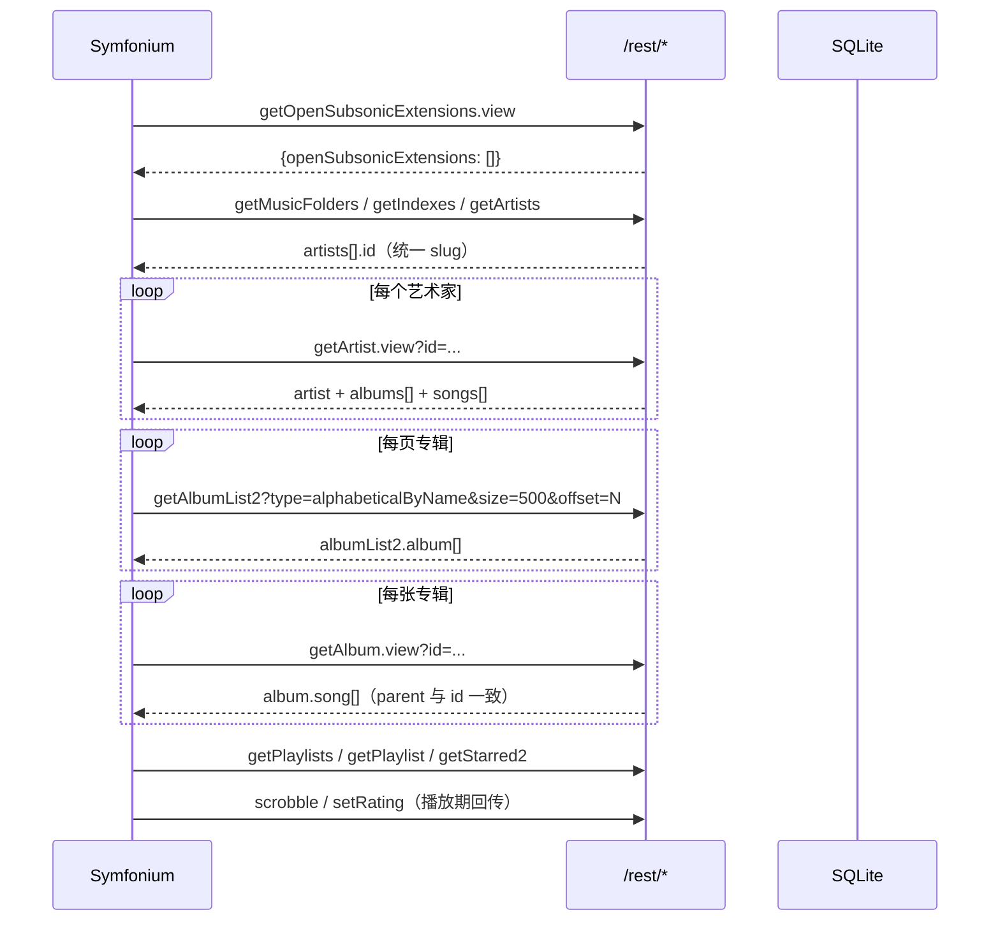

# MusicOn 项目全面分析报告

> 分析对象：`gefl24/music-on`（Docker 镜像 `geelonn/musicon:latest`，v1.8.9，2026-05-07 构建）
> 分析日期：2026-10-29
> 分析范围：后端 38 个 Python 文件 / 12,489 行、15 张数据表、94 个 Subsonic 路由、41 组 Web API 路径、前端构建产物

---

## 0. 资料来源与重要说明

| 来源 | 内容 | 说明 |
| --- | --- | --- |
| GitHub `gefl24/music-on` | `README.md`、`tag/logo.svg`、2 张界面截图 | **仓库没有源代码**，只有文档与图片；无 LICENSE 文件（README 徽章写 MIT） |
| GitHub Issues | #1 部署报错、#2 歌词不显示、#3 PlaySub 无法连接、#4 Symfonium 无法同步 | #4 即本次修复目标，作者已确认 Nginx 绕过方案无效 |
| Docker Hub `geelonn/musicon:latest` | 完整运行镜像（~156 MiB 压缩层） | 通过镜像层解包得到 `/app` 下的 FastAPI 源码、`/app/static` 前端产物、`/app/vendor/lxserver` |
| 镜像构建历史 | `COPY backend/ /app/`、`COPY /frontend/dist /app/static`、`COPY /lxserver/...` | 证明上游是 monorepo：`backend/` + `frontend/` + `lxserver/` |

因此本仓库的“源码”由三部分组成：

1. **后端源码**：从镜像中完整提取（`.py`，未编译，可直接修改/重建）。
2. **前端**：上游只发布了 Vite 构建产物（`index-*.js` 单文件、压缩混淆、无 source map），**无法还原 Vue 源码**；本仓库原样保留在 `frontend/dist`。
3. **LX Music Server**：上游把第三方 `lxserver` 连同 `node_modules` 一起打进镜像（源码 18 MB + 依赖 33 MB）。它不属于 MusicOn 自身代码，本仓库未收录，见 §9.4。

---

## 1. 项目定位

MusicOn 是一个**面向云盘音乐库的个人音乐中心**：

- 把 AList / 夸克 / 115 网盘中的音乐目录扫描进本地数据库；
- 通过 **Subsonic 1.16.1 协议**向 Symfonium、音流、DSub、PlaySub 等客户端提供曲库与串流；
- 自带 Vue 3 Web 控制台做曲库管理、扫描任务、歌单、统计；
- 集成 LX Music Server 拉取全网榜单、生成“精选歌单”，并支持把在线歌曲自动下载/补全到自己的网盘（“自动补全”）；
- 播放时 302 跳转到网盘直链，**不消耗服务器带宽**（夸克走反向代理以带 Cookie）。

### 1.1 功能矩阵

| 能力 | 实现 | 关键文件 |
| --- | --- | --- |
| 多存储源 | AList、夸克（Cookie/开放平台）、115、夸克 TV | `app/services/storage/providers_*.py` |
| 异步扫描 | 全量 / 增量，目录快照 + 文件索引 + 脏目录，8~16 并发 | `scan_service.py` |
| 元数据解析 | HTTP Range 读头部 + mutagen 解析 FLAC/MP3/M4A/APE… | `scan_service._parse_and_extract` |
| 封面处理 | Pillow 统一转 WebP、限 800×800、按 SHA1 去重、缩略图 | `cover_cache.py` |
| Subsonic | 1.16.1 + 部分 OpenSubsonic，40+ 端点 | `api/subsonic.py` |
| 播放 | 302 直链 / 夸克代理 / 115 重定向 / LX 虚拟歌 | `subsonic.stream` |
| Web 控制台 | 登录 Cookie、曲库、歌单、扫描、设置、日志 | `api/app_data.py` + `frontend/dist` |
| 榜单 | 5 大榜单（tx/wy/kg/kw/mg）加权合并，每日 00:05、12:03 | `curation_service.py` |
| 自动补全 | LX 搜索 → 下载 → 嗅探格式 → 注入标签/封面/歌词 → 上传网盘 → 触发重扫 | `auto_fill_service.py` |
| 定时任务 | APScheduler（Asia/Shanghai） | `scheduler.py` |
| 用户体系 | Web 管理员 + 独立 Subsonic 用户表 | `web_auth.py`、`db_data` |

---

## 2. 技术栈

| 层 | 技术 |
| --- | --- |
| 后端 | Python 3.12、FastAPI 0.111、Uvicorn、SQLAlchemy 2.0（Core，非 ORM）、Pydantic v2 |
| 数据库 | SQLite（默认）或 PostgreSQL 16（`DATABASE_URL` 切换，启动时 `CREATE TABLE IF NOT EXISTS` + `ADD COLUMN` 自迁移） |
| 媒体 | mutagen 1.47、Pillow 10.3（WebP）、HTTP Range |
| 网络 | httpx 0.27（同步 + 异步）、h2 |
| 调度 | APScheduler 3.10（AsyncIOScheduler） |
| 前端 | Vue 3 + Vite 构建产物（`index-*.js` 305 KB、CSS 48 KB），由 FastAPI 同源托管 |
| 外部服务 | AList、夸克开放平台、115、LX Music Server（Node.js，可内嵌或远程） |
| 部署 | 单容器 + tini；`amd64`/`arm64`；健康检查 `GET /health` |

---

## 3. 仓库结构（本仓库）

```text
bananamusic/
├── backend/                     # FastAPI 后端（来自镜像 /app）
│   ├── app/
│   │   ├── main.py              # 应用装配、鉴权中间件、SPA 兜底
│   │   ├── api/
│   │   │   ├── app_data.py      # Web API（1301 行）
│   │   │   ├── subsonic.py      # Subsonic 兼容层（1596 行）
│   │   │   └── health.py
│   │   ├── core/
│   │   │   ├── config.py        # pydantic-settings
│   │   │   └── slugs.py         # 【新增】统一实体 ID
│   │   ├── db/                  # engine、SQLite/PG 兼容层
│   │   ├── services/
│   │   │   ├── db_data.py       # 全部 SQL 与业务读写（2044 行）
│   │   │   ├── scan_service.py  # 扫描器（771 行）
│   │   │   ├── auto_fill_service.py
│   │   │   ├── curation_service.py
│   │   │   ├── alist_client.py
│   │   │   ├── cover_cache.py
│   │   │   ├── lx_runtime.py    # 内嵌 LX Server 生命周期
│   │   │   ├── scheduler.py
│   │   │   ├── app_settings.py
│   │   │   ├── web_auth.py
│   │   │   └── storage/         # 存储抽象 + 4 个 provider
│   │   ├── workers/scan_worker.py
│   │   └── …
│   ├── scripts/                 # PG→SQLite 迁移、重复曲目审计、清理脚本
│   ├── requirements.txt
│   └── README.md / DUPLICATE_SONG_AUDIT.md / STORAGE_PROVIDER_MIGRATION.md
├── frontend/dist/               # 上游构建产物（无源码）
├── docker/                      # Dockerfile、start-app.sh
├── docs/                        # 本报告、修复说明、补丁、截图
└── tools/                       # 复现脚本、216 项协议一致性测试
```

---

## 4. 架构总览



### 4.1 启动流程（`app/main.py`）

1. `ensure_settings_table()` → 建/补 `app_settings`，写入默认值（含 `subsonic_user/pass`）。
2. `init_database()` → 建 15 张表，逐列 `ADD COLUMN` 兼容旧库；把空 `provider_id` 回填为上次扫描源。
3. `ensure_curated_playlists()` → 建 5 个系统精选歌单。
4. 注册 CORS、`subsonic_json_hint` 中间件（注入 `f=json|xml` 到 ContextVar、打印脱敏日志、保护 `/api/*`）。
5. 挂载 `/assets`、`/app/data`，SPA 兜底路由。
6. lifespan：启动 APScheduler、尝试拉起内嵌 LX Server；退出时停止。

---

## 5. 数据模型（15 张表）

| 表 | 主要字段 | 用途 |
| --- | --- | --- |
| `songs` | id(PK), title, artist, album, fmt, dur, path, plays, raw_url, provider_id, cover_path, cover_art, genre, album_artist, lyrics, created_at, updated_at | 曲库主表；`id` 由扫描生成 |
| `scan_tasks` | id, path, mode, count/total/processed, status, source, logs(JSON), end_time | 扫描/补全任务与日志 |
| `scan_state` | root_path(PK), state(JSON), updated_at | 增量扫描的目录快照 |
| `file_index` | root_path, file_path(PK 组合), size, mtime, is_audio, last_seen_at | 增量扫描的文件级索引 |
| `dirty_dirs` | dir_path, reason | 补全上传后标记待重扫目录 |
| `play_history` | id, song_id, played_at, source, submission, client | 播放历史/统计 |
| `playlists` | id, name, comment, owner, public, is_readonly, scope, song_count, duration | 歌单（私有/公开系统） |
| `playlist_tracks` | id, playlist_id, song_id, sort_order | 歌单曲目 |
| `subsonic_users` | username(唯一), password, role, enabled | 独立 Subsonic 账号 |
| `starred_items` | username, item_type(song/album/artist), item_id, created_at | 收藏 |
| `ratings` | username, song_id, rating(0-5) | 评分 |
| `bookmarks` | username, song_id, position_ms, comment | 播放书签 |
| `app_settings` | key(PK), value, updated_at | 全部运行配置（含加密/脱敏逻辑） |
| `curation_update_history` | 榜单更新批次、统计 JSON、错误 | 榜单执行历史 |
| `autofill_failed_uploads` | 歌曲/文件名/失败原因/次数 | 补全失败重试清单 |

设计特点：

- 全库**不用外键**，删除歌曲时手工清理 `play_history / playlist_tracks / ratings / bookmarks`。
- 时间字段在 SQLite 下是 TEXT，在 PG 下是 `TIMESTAMPTZ`，由 `app/db/compat.py` 抹平。
- JSON 字段在 SQLite 下是 TEXT、PG 下是 JSONB。

---

## 6. 核心模块详解

### 6.1 存储抽象层

`StorageService` 对上层暴露统一接口：`list_dir(_async)`、`stat`、`exists`、`mkdir`、`get_download_url(_async)`、`read_range(_async)`、`read_text_async`、`write_bytes_async`、`search`、`normalize_path`。

`build_storage_service()` 按配置动态实例化：

| type | 类 | 认证方式 |
| --- | --- | --- |
| `alist` | `AlistStorageProvider` | Token 或 用户名/密码换 token |
| `quark` | `QuarkStorageProvider` | Cookie（可含 `__pus`/`__puus`），开放平台可配 `open_base_url` |
| `115` | `OneOneFiveStorageProvider` | Cookie / 扫码 token；上传走 OSS STS（依赖 `oss2`、`p115client`） |
| `quark_tv` | `QuarkTVStorageProvider` | refresh_token + device_id |

`get_storage_service()` 用 `lru_cache(maxsize=1)` 缓存；修改设置后由 `_refresh_storage_service_cache()` 失效重建。这是**单进程假设**：多 worker 部署时各进程缓存不一致。

### 6.2 扫描管线（`scan_service`）

1. **模式**：`full` 忽略历史快照；`incremental` 读取 `scan_state.dirs` + `file_index` + `dirty_dirs`。
2. **遍历**：BFS 目录，`MAX_SCAN_ITEMS = 50_000` 上限；对每个目录计算 `children_hash` 快照，未变化则跳过（增量）。
3. **并发**：`asyncio.Semaphore(worker_count)`（默认 8，最大 16），每个文件：
   - 先读 64 KB；根据格式决定是否读 8 MB/16 MB（FLAC 封面常在尾部）；
   - `run_in_executor` 交给线程池用 mutagen 解析；
   - 提取 title/artist/album/genre/时长/内嵌封面/内嵌歌词；
   - 封面交给 `cover_cache.save_cover_bytes()` 统一转 WebP。
4. **兜底**：标签缺失时按路径 `.../艺术家/专辑/歌曲.flac` 推断（`_split_path`）。
5. **落库**：批量 `_upsert_songs`（SQLite `ON CONFLICT DO UPDATE`），回填 `provider_id`；记录 `file_index`；最后写 `scan_state`。
6. **进度**：`progress_callback` 写入 `scan_tasks.logs`，Web 控制台轮询展示。
7. **取消**：全局 `CANCELLED_TASKS` 集合 + `gc.collect()`。

### 6.3 播放链路（`subsonic.stream` / `download`）

| 歌曲类型 | 行为 |
| --- | --- |
| 普通云盘歌（quark） | 实时换取下载直链，再由服务端**反向代理**（带 Cookie/Referer/UA），支持 Range |
| 普通云盘歌（115 / alist） | `get_download_url_async()` → **302** 到直链 |
| 虚拟在线歌（`path = lx://virtual/...`） | 解析 `raw_url` JSON → 调 LX `/api/music/url` → 302 到在线音源 |

`raw_url` 对虚拟歌保存 LX 的 `songInfo`（source/songmid/img/...），是“榜单歌曲即使网盘没有也能秒播”的关键。

### 6.4 Web API（`app_data.py`，41 组路径）

- 认证：`POST /api/web-auth/login` 校验管理员账号密码，下发 `HttpOnly; SameSite=Lax` Cookie；token = `username:sha256(username|password|musicon-web)`（**无过期时间，改密即失效**）。
- 曲库：`/api/songs`、`/api/songs/{id}`、`PUT` 编辑、`DELETE` 批量删、`/api/songs/{id}/stream`、`/api/covers/thumb/{size}/{file}`。
- 扫描：`POST /api/scan`、`/api/scan/schedule`、`/api/tasks*`、取消/删除。
- 设置：`/api/settings`（敏感字段脱敏）、存储连通性测试、夸克 TV/115 扫码登录轮询、LX 自定义音源。
- 歌单：CRUD、导入、单个歌单自动补全、系统歌单初始化。
- 统计：`/api/stats`、`/api/plays/recent`、`/api/songs/top`。
- 其他：`/api/alist/search`、`/api/music/metadata-search|lyric`、`/api/curation/*`、`/api/auth/subsonic-token`。

### 6.5 Subsonic 兼容层（`subsonic.py`）

- 路由前缀 `/rest`，每个端点同时注册 `xxx` 与 `xxx.view`（本次修复补齐了 3 个遗漏）。
- 响应格式由 `f=json|xml` 决定，使用 `ContextVar` 传递；XML 由手写 `_xml_append` 递归序列化（dict → 属性 + 子元素，list → 重复元素）。
- 认证：`u` + `t=md5(password+salt)` + `s`；本次新增 `p=`（hex/明文）兼容。
- 实体 ID：艺术家/专辑/歌曲的 id 全部由名称/主键推导，**列表与详情必须使用同一函数**（本次修复核心）。
- 端点覆盖（40+）：`ping`、`getLicense`、`getOpenSubsonicExtensions`、`getMusicFolders`、`getIndexes`、`getArtists`、`getArtist`、`getArtistInfo(2)`、`getAlbumList(2)`、`getAlbum`、`getAlbumInfo(2)`、`getSong`、`getMusicDirectory`、`search2/3`、`getGenres`、`getSongsByGenre`、`getPlaylists/Playlist`、`create/update/deletePlaylist`、`getStarred(2)`、`star/unstar`、`setRating`、`saveBookmark/getBookmarks`、`getRandomSongs`、`getTopSongs`、`getSimilarSongs(2)`、`getNowPlaying`、`scrobble`、`getScanStatus`、`startScan`、`getLyrics`、`getLyricsBySongId`、`stream`、`download`、`getCoverArt`、`getUser`。

### 6.6 LX 集成与“榜单/补全”

- `lx_runtime.LxEmbeddedManager`：在容器内 `node index.js` 拉起 `/app/vendor/lxserver`，端口 9527；也支持 `lx_service_mode=remote` 指向外部 LX Server。
- `curation_service`：从 5 个音源榜单拉取，按 `(标题, 艺术家)` 去重并按排名加权（`max(100-rank+1,1) × 音源权重`）合并成 5 个系统歌单；能匹配到本地歌曲时替换为本地版本，否则保留 `lx://virtual/` 虚拟歌。
- `auto_fill_service`：对歌单中缺失的歌曲调用 LX 搜索，按顺序尝试音质（flac→320k→128k），用 magic bytes 校验真实格式，`mutagen` 注入标题/艺术家/专辑/封面/歌词，上传到网盘目录，校验大小，标记 `dirty_dirs` 等待增量重扫。
- 定时：`00:05`、`12:03`（Asia/Shanghai）刷新榜单，可选联动补全。

### 6.7 调度器

`setup_scheduler()` 读取 `cron_expr`（自定义扫描）与 `lx_cron_expr`（榜单），使用 `CronTrigger.from_crontab`。
注意：保存设置会调用 `update_cron_schedule()` **重启整个 scheduler**；`scheduler` 是模块级单例，多 worker 下会重复执行。

---

## 7. 关键链路时序

### 7.1 扫描



### 7.2 Symfonium 同步（修复后）



---

## 8. Subsonic / OpenSubsonic 兼容性矩阵

| 能力 | 状态 | 说明 |
| --- | --- | --- |
| 1.16.1 基础端点 | ✅ | 40+，见 §6.5 |
| JSON / XML 双格式 | ✅ | 手写 XML 序列化，已修 `openSubsonicExtensions` 包装 |
| 分页 `size/offset` | ✅ | `getAlbumList(2)`、`search3`、`getStarred2` 不涉及；`getSongsByGenre` 本次补 `offset` |
| `starred` 时间语义 | ✅ 本次修复 | ISO-8601 或省略 |
| `created/changed` | ✅ 本次修复 | RFC3339 `...Z` |
| 实体 ID 可回查 | ✅ 本次修复 | `slugs.py` 单一实现 |
| `p=` 认证 | ✅ 本次新增 | 兼容 PlaySub 等旧客户端（issue #3） |
| OpenSubsonic 扩展 | ⚠️ 空数组 | 不再虚假声明 `transcodeOffset`；未实现 `apiKeyAuthentication`、`formPost` |
| 转码 `maxBitRate/format` | ❌ | `stream` 直接 302，无服务端转码 |
| `byYear/fromYear/toYear` | ⚠️ | 接受参数但不生效（库里没有 year 字段，恒为 0） |
| `getAlbumList2?type=starred` | ✅ 本次实现 | 基于收藏歌曲反推专辑 |
| `getPlayQueue/savePlayQueue` | ❌ | 未实现，客户端会 404（不影响曲库同步） |
| `getShares/getPodcasts/getVideos/getRadio` | ❌ | 未实现 |
| 专辑/艺术家收藏 `starred` | ⚠️ | 表里有，但专辑对象未输出 `starred` 字段 |
| 歌词 | ✅ | `getLyrics` + `getLyricsBySongId`（无时间轴） |
| 封面 | ✅ | 有封面才返回；缺失时 404 |
| 评分/书签/播放上报 | ✅ 本次修复 | `setRating` 此前必 500 |

---

## 9. 代码质量与风险清单

### 9.1 正确性风险（高）

| # | 问题 | 影响 | 状态 |
| --- | --- | --- | --- |
| 1 | `openSubsonicExtensions` 对象/数组不匹配 | Symfonium 同步直接中止 | ✅ 已修 |
| 2 | 列表与详情 ID 规则不一致 | 特殊字符艺术家/专辑 404，同步中断 | ✅ 已修 |
| 3 | `starred` 用布尔值 | 严格 JSON 解析失败 | ✅ 已修 |
| 4 | `indexes.shortcut` 对象 | 解析失败 | ✅ 已修 |
| 5 | `search3/scrobble` 缺 `.view` | 搜索/播放上报 404 | ✅ 已修 |
| 6 | `setRating` SQL 少了 `f` | 评分 500 | ✅ 已修 |
| 7 | 时间戳非 ISO | 部分客户端解析异常 | ✅ 已修 |

### 9.2 性能风险（中）

- **N+1 查询**：`to_subsonic_song()` 每首歌查 3 次（starred / rating / bookmark）。`getAlbum`、`getPlaylist`、`getStarred2` 都会放大。
- **全表加载**：`list_songs()` 在每个 `getArtist`、`getSong` 之外的列表接口里被调用；`getIndexes`、`getScanStatus`（`_library_stats`）亦然。1311 位艺术家同步时约 1300 次全表扫描。
- **重复聚合**：`build_album_list()` 每次分页都重新分组；`getAlbumList2` 每页一次。
- **无索引**：`songs(artist)`、`songs(album)`、`songs(genre)` 均无索引。
- 结论：当前 ~600 首规模可用；1 万首以上建议加索引 + 请求级缓存/批量查询。

### 9.3 安全风险（中）

| 项 | 说明 |
| --- | --- |
| 默认口令 | `admin/changeme`；README 提醒修改，但无强制 |
| 密码存储 | `subsonic_users.password`、`app_settings.subsonic_pass` 明文；Subsonic token 仅为 `md5(pass+salt)`（协议限制） |
| Web 会话 | SHA256 静态盐、无过期、无刷新；Cookie `HttpOnly` 已设置，`Secure` 未设置（HTTP 部署会明文传输） |
| CORS | `allow_origins=['*']` + `allow_credentials=True`：浏览器会拒绝携带凭证的跨域请求，且语义上过宽 |
| SSRF | AList 地址、LX 自定义音源 URL、虚拟歌封面 URL 均可由管理员配置；`/api/lx/custom-sources/import-url` 会服务端抓取任意 URL |
| 数据暴露 | `/app/data` 静态挂载（封面等）无需认证 |
| 暴力破解 | 登录接口无速率限制 |
| 依赖 | `requirements.txt` 未锁 `cryptography`（本次补），`p115client/oss2` 版本较旧 |

### 9.4 可维护性风险

- **前端源码缺失**：只有压缩后的 `index-*.js`，无法二次开发 UI、无法审计前端逻辑、无法做安全扫描（这是上游发布方式导致）。
- **LX Server 体积**：镜像含 18 MB 源码 + 33 MB `node_modules`；本仓库未收录，内嵌模式需自行补齐。
- **超大文件**：`db_data.py` 2044 行、`subsonic.py` 1596 行、`app_data.py` 1301 行，SQL 与业务混杂。
- **重复实现**：`demo_data.py` 里还有一份 `list_songs/build_indexes/build_album_list`。
- **无测试**：上游没有任何自动化测试；本次新增 216 项协议测试与复现脚本。
- **手写迁移**：启动时 `ADD COLUMN`，无版本号/alembic 迁移历史。
- **单进程假设**：`lru_cache`、模块级 `scheduler`、`CANCELLED_TASKS`、`ContextVar` 都假设单 worker。
- **硬编码路径**：`/app`、`/app/vendor/lxserver`（封面目录已改为可通过 `MUSICON_DATA_DIR` 覆盖）。

---

## 10. 本次修复与验证摘要

详见 `docs/SUBSONIC_FIX.md`。核心改动：

- 新增 `app/core/slugs.py`，统一艺术家/专辑 ID；
- 修正 `openSubsonicExtensions`、`indexes.shortcut`、`starred`、时间戳等 JSON/XML 形状；
- 补齐 `.view` 路由、`p=` 认证、`getSongsByGenre?offset`、`getAlbumInfo2`、`getSimilarSongs2`、`getLyricsBySongId`；
- 修复 `setRating` SQL、`getNowPlaying` 时间格式化、`createPlaylist?playlistId`、`getAlbumList` 分页；
- `startScan` 返回真实状态；`getArtist` 不再截断 20 首；
- 版本号 1.9.1，`requirements.txt` 补 `cryptography`，源码运行自动定位 `frontend/dist`。

验证结果：`tools/test_subsonic_compliance.py` 216 项断言全部通过；真实 Uvicorn 冒烟测试通过（前端、健康检查、未知路由 404、JSON/XML 响应）。

---

## 11. 部署建议

1. **生产优先 PostgreSQL**（README 方案 B），SQLite 在扫描/同步并发下写锁明显。
2. **必须修改默认口令**，并在反代层启用 HTTPS + `Secure` Cookie + 速率限制。
3. 单 worker 运行（`uvicorn` 默认 1），或把缓存/调度器改为 Redis/外部调度后再扩容。
4. 定期备份 `./data`（SQLite、封面）与 `app_settings`。
5. 若不需要“榜单/自动补全”，可设 `LX_EMBEDDED_ENABLED=false`，避免无谓的 Node 进程与启动告警。
6. 反向代理注意：Subsonic 302 直链需要客户端能访问网盘域名；夸克已由服务端代理，115/AList 是跳转。

## 12. 后续改进路线（建议）

1. 为 `songs(artist/album/genre)` 建索引；把 `to_subsonic_song` 的 3 次查询改为请求级批量预取。
2. 给 Subsonic 增加 ETag/Last-Modified 与 `getSongsByGenre`、`getStarred2` 的增量语义。
3. 把 `openSubsonic` 扩展补齐：`apiKeyAuthentication`、`formPost`、`transcodeOffset`（或继续声明空）。
4. 为 Web 会话加签名过期时间与 `Secure` 标记；为登录加限流。
5. 用 Alembic 管理 schema，替代 `ADD COLUMN`。
6. 向上游提交本次 Subsonic 修复 PR（上游仓库无源码，需先与作者沟通）。
